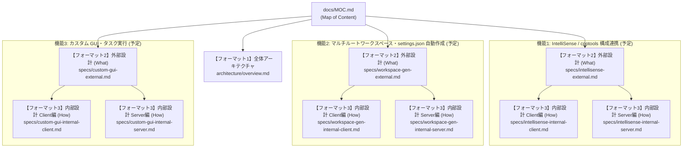

# vcxBridge 設計・開発ドキュメント (Map of Content)

本ファイル（`docs/MOC.md`）は、**vcxBridge** の開発者向け設計書・仕様書の目次（Map of Content）です。

> [!IMPORTANT]
> **設計資料の3階層フォーマットと責務分離ルール**
> - **利用者向け説明**: ルートの `README.md` にのみ記述する。
> - **システム設計資料 (`docs/`)**: 以下の3階層フォーマット（詳細は `.agents/skills/architecture-docs/SKILL.md` 参照）に厳格に分離して管理する。
>   1. **【フォーマット1】全体アーキテクチャ（共通基盤）**: システム全体の境界・技術スタック・共通通信・永続化方針
>   2. **【フォーマット2】外部設計（機能の親資料・What）**: UI仕様・公開IF・業務フロー・ユーザー向けエラー仕様（※内部ロジック厳禁）
>   3. **【フォーマット3】内部設計（機能の子資料・How）**: モジュール構造・データ構造・シーケンス/アルゴリズム・内部例外処理（※Client / Server の技術境界ごとに分割、UI表現の混在厳禁）

---

## 1. ドキュメント階層マップ

---

## 2. 全体アーキテクチャ (`docs/architecture/`)

| 分類 | ドキュメントリンク | 概要・ステータス |
| :--- | :--- | :--- |
| **全体アーキテクチャ** | [[architecture/overview\|vcxBridge 全体アーキテクチャ]] | システム全体概要、Client/Server 境界と技術スタック、共通通信・データ管理方針（一部 TBD 含む） |

---

## 3. 機能別設計書 (`docs/specs/`)

各機能は **外部設計（親資料・What）** と、実行環境・技術境界（TypeScript Client / Python Server）ごとに分割した **内部設計（子資料・How）** で構成します。

| 機能領域                                   | 外部設計（親資料・What）                                             | 内部設計（子資料・How）                                                                                                                                      | ステータス     |
| :------------------------------------- | :--------------------------------------------------------- | :------------------------------------------------------------------------------------------------------------------------------------------------- | :-------- |
| **IntelliSense / `cpptools` 構成連携**     | `[[specs/intellisense-external\|IntelliSense 構成連携（外部設計）]]` | ・`[[specs/intellisense-internal-client\|内部設計 (Client編)]]` ・`[[specs/intellisense-internal-server\|内部設計 (Server / .vcxproj解析編)]]`                | 未作成（今後策定） |
| **マルチルートワークスペース・`settings.json` 自動作成** | `[[specs/workspace-gen-external\|ワークスペース・設定自動作成（外部設計）]]`   | ・`[[specs/workspace-gen-internal-client\|内部設計 (Client / ファイル生成・反映編)]]` ・`[[specs/workspace-gen-internal-server\|内部設計 (Server / ソリューション構造解析編)]]` | 未作成（今後策定） |
| **カスタム GUI・タスク実行**                     | `[[specs/custom-gui-external\|カスタム GUI・タスク実行（外部設計）]]`      | ・`[[specs/custom-gui-internal-client\|内部設計 (Client編)]]` ・`[[specs/custom-gui-internal-server\|内部設計 (Server / タスク制御編)]]`                         | 未作成（今後策定） |

---

## 4. 未決定事項・今後の設計テーマ (Open Topics / TBD)

[[architecture/overview|vcxBridge 全体アーキテクチャ]] において「検討中（TBD）」としている以下の項目は、機能設計フェーズと合わせて順次確定します。

1. **Client — Server 間通信プロトコルの正式決定**:
   - **候補 A**: FastAPI (HTTP REST / WebSocket) — 現在 `server/app/main.py` にプロトタイプ配置
   - **候補 B**: JSON-RPC 2.0 over Stdio — ポート競合がなくプロセス寿命管理が容易
2. **`.vcxproj` / `.sln` 解析アプローチ**:
   - MSBuild プロパティシート（`.props` / `.targets`）および条件分岐（`Condition`）の評価範囲
   - MSBuild CLI 連携と独自 XML パーサーの使い分け
3. **マルチルートワークスペース（`.code-workspace`）および `.vscode/settings.json` 自動作成仕様**:
   - 生成トリガー（初回オープン時の自動生成／コマンド実行）および出力先パス規則
   - 既存の `.code-workspace` や `.vscode/settings.json` が存在する場合のマージ・上書き保護方針
4. **カスタム GUI 設定ファイル形式とキャッシュ戦略**:
   - 利用者が自由にタスク・コマンドを定義するための設定ファイル形式（JSON / YAML 等）
   - 解析結果キャッシュの無効化（Invalidation）条件
