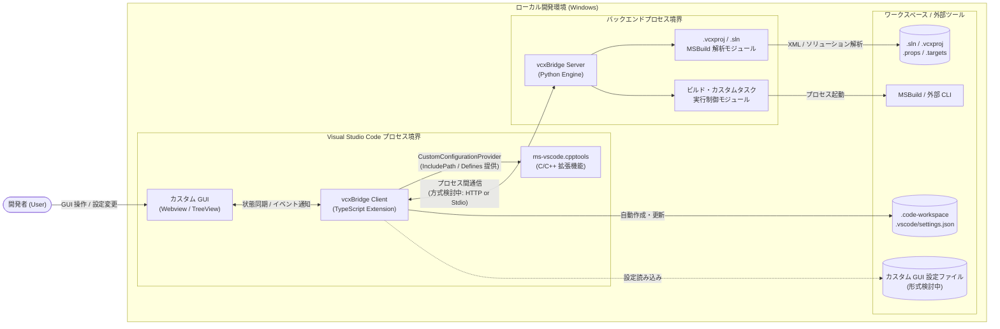
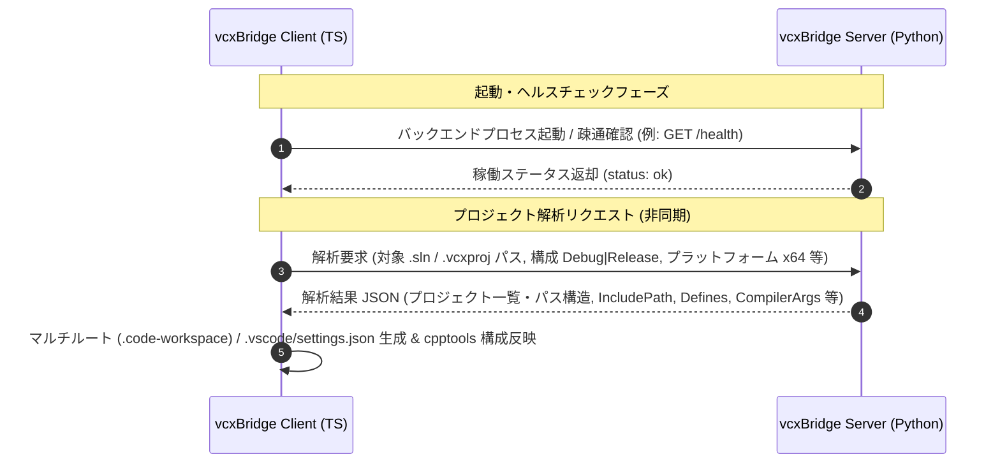

# vcxBridge 全体アーキテクチャ
---
## 1. システム全体概要

### 目的

- Visual Studio の C++ プロジェクト（`.sln` / `.vcxproj` / `.props` / `.targets`）を Visual Studio Code 上で扱う際、MSBuild 固有の条件分岐（`Condition`）やプロパティ継承が原因で正確なインクルードパス・マクロ定義が解決できず、IntelliSense の誤検知やコードジャンプ不全が発生する。
- 複数のプロジェクトを含む大規模ソリューション（`.sln`）を VS Code で扱う際、マルチルートワークスペース（`.code-workspace`）や各プロジェクトの `.vscode/settings.json` を手動で構成・維持する負荷が高い。
- Visual Studio IDE に依存していたビルドやプロジェクト固有の定型作業（コード生成・デプロイ・テスト実行など）を、VS Code 上で直感的に操作・カスタマイズする手段が不足している。

### スコープ

1. **IntelliSense / Browse 構成連携機能**: `.vcxproj` 等を解析し、`ms-vscode.cpptools` の **Custom Configuration Provider API** へ正確なコンパイル構成（インクルードパス、マクロ定義、コンパイラオプション等）を提供する。
2. **マルチルートワークスペース・`settings.json` 自動作成機能**: `.sln` / `.vcxproj` の解析結果に基づき、複数プロジェクト構成に応じたマルチルートワークスペース（`.code-workspace`）および `.vscode/settings.json` を自動作成する。
3. **カスタム GUI・タスク実行機能**: ビルド作業やユーザー定義の各種タスク・コマンド・ワークフローを、VS Code 上のカスタム GUI（Webview / TreeView 等）から定義・実行可能にする。

---

## 2. コンポーネント構成と技術スタック

### システム境界と役割

  - VS Code の UI・拡張機能 API 連携・ワークスペース構成ファイル生成を担う **Client (`client/`)** と、負荷の高いプロジェクト解析・バックエンド処理を担う **Server (`server/`)** のハイブリッドアーキテクチャを採用し、プロセスおよび責務を明確に分離する。

| コンポーネント | 物理パス | 責務（Role） | 境界上の制約 |
| :--- | :--- | :--- | :--- |
| **vcxBridge Client** | `client/` | 拡張機能ライフサイクル管理、`ms-vscode.cpptools` API 連携、マルチルートワークスペース（`.code-workspace`）および `.vscode/settings.json` の自動作成・VS Code 反映、カスタム GUI（Webview / TreeView）の描画・操作受付、Server プロセスの起動・監視 | 重い XML パースや MSBuild 条件評価ロジックを直接実装しない |
| **vcxBridge Server** | `server/` | `.sln` / `.vcxproj` / `.props` の構造・XML 解析（マルチプロジェクト構成抽出を含む）、MSBuild 条件・マクロ評価、構成情報の抽出、バックエンドタスク制御 | VS Code 固有の UI 状態や API に直接依存しない |

### 採用技術

| レイヤー / 用途 | 採用技術・バージョン | 選定理由 |
| :--- | :--- | :--- |
| **Client 実装言語** | TypeScript (`strict: true`, Node.js 20+) | VS Code Extension API および `vscode-cpptools` 型定義との親和性、静的型付けによる安全性確保のため |
| **Client テスト** | Vitest | TypeScript の高速な単体テスト・モック検証を実現するため |
| **Server 実装言語** | Python 3.12+ | XML 解析や柔軟なテキスト・データ構造処理、高速なプロトタイピングと豊富な標準/外部ライブラリの活用が可能であるため |
| **データ検証 / スキーマ** | Pydantic v2 | Client - Server 間の入出力データ構造に対する厳格な型検証とシリアライズを保証するため |
| **Server テスト** | pytest | Python バックエンドの単体・結合テストおよびフィクスチャ管理の標準デファクトであるため |
| **通信フレームワーク** | **検討中（TBD）** *(現行プロトタイプ: FastAPI + Uvicorn)* | 下記「3. 共通通信・連携仕様」にて比較・正式決定予定 |

---

## 3. 共通通信・連携仕様

### システム間連携

  - **1. Client — `ms-vscode.cpptools` 間連携（確定）**:
    - `vscode-cpptools` パッケージの `CustomConfigurationProvider` インターフェースを介してインプロセス連携を行う。
    - 翻訳単位（ソースファイル）ごとの `SourceFileConfigurationItem` およびワークスペース全体の `WorkspaceBrowseConfiguration` を非同期（Promise）で返却する。
  - **2. Client — Server 間通信プロトコル（検討中 / TBD）**:
    - 現在、以下の2方式を候補として比較検討中であり、今後正式決定する。

| 比較項目 | 候補 A: FastAPI (HTTP REST / WebSocket) ※現行プロトタイプ | 候補 B: JSON-RPC 2.0 over Stdio |
| :--- | :--- | :--- |
| **通信経路** | ローカルループバック (`127.0.0.1:<port>`) 上の HTTP / WebSocket | 子プロセスの標準入出力パイプ (`stdin` / `stdout`) |
| **メリット** | `server/app/main.py` にプロトタイプ配置済み。単体での curl / ブラウザ / OpenAPI (Swagger) デバッグが容易 | 空きポート探索やファイアウォール警告が不要。VS Code Language Server 等で実績豊富でプロセス寿命管理が確実 |
| **デメリット / 課題** | 複数 VS Code ウィンドウ起動時の動的ポート割当とゾンビプロセス管理が必要 | 標準出力へのデバッグログ混入防止など、ストリームフレーミング制御が必要 |
| **API 基本原則** | リクエスト・レスポンスともに UTF-8 JSON とし、Pydantic モデルでスキーマを厳格に定義する。UI スレッドをブロックしないよう Client 側はすべて非同期（Async/Await）で呼び出す。 | 同左 |

---

## 4. データストア・共通管理方針

### 永続化層

  - 本システムは外部 RDBMS 等の専用データベースサーバーを持たず、ファイルシステム上の設定ファイルおよびインメモリ／ローカルキャッシュで状態を管理する。詳細仕様は **検討中（TBD）**。

| 管理対象データ                        | 保存先・種別                                       | スキーマ・キャッシュ管理方針（検討中 / TBD）                                                                                                       |
| :----------------------------- | :------------------------------------------- | :------------------------------------------------------------------------------------------------------------------------------ |
| **マルチルートワークスペース定義**            | `<solution>.code-workspace` (JSON)           | Server による `.sln` / `.vcxproj` 解析結果（含まれる各プロジェクトのルートパス等）をもとに Client が自動生成・更新する（既存設定とのマージ方針は TBD）                                 |
| **VS Code ワークスペース / プロジェクト設定** | `.vscode/settings.json` / User Settings      | VS Code 標準の `contributes.configuration` による拡張設定定義に加え、プロジェクト解析結果に基づく推奨設定・構成情報の自動出力を Client が行う（既存ファイルのマージ・上書き制御は TBD）            |
| **カスタム GUI・タスク定義**             | ワークスペース内設定ファイル *(候補: JSON または YAML)*      | ユーザーが定義するボタン配置・実行コマンド・引数のスキーマを定義予定。ファイル変更監視（FileSystemWatcher）によるホットリロードを想定                                                     |
| **プロジェクト解析キャッシュ**              | Server インメモリキャッシュ *(および必要に応じたローカル一時ファイル)* | `.vcxproj` / `.props` の更新タイムスタンプ（またはハッシュ値）と選択中の Configuration / Platform（例: `Debug\|x64`）をキーとして解析結果をキャッシュし、同一構成での再解析コストを最小化する方針 |
