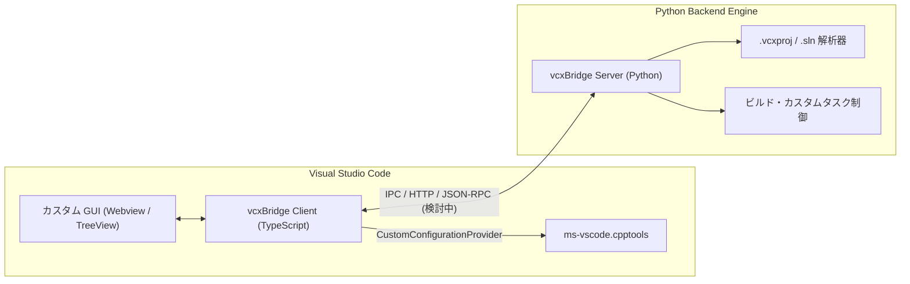

# システム全体概要 (Architecture Overview)

## 1. 背景と目的
Visual Studio の C++ プロジェクト（`.sln`, `.vcxproj`）を Visual Studio Code で開いた際、以下の課題を解決する拡張機能 **vcxBridge** を構築します。

1. **高精度な IntelliSense / Browse 提供**:
   - `.vcxproj` や関連 `.props` を解析し、`cpptools` の Configuration Provider へ正確な IncludePath・Defines・コンパイラ設定を渡す。
2. **ユーザーカスタマイズ可能な GUI**:
   - ビルド実行だけでなく、利用者がプロジェクト固有の作業（コード生成、デプロイ、テスト実行、カスタムスクリプト等）を GUI 上のボタンやパネルから直感的に実行できるようカスタム可能な UI を提供する。

## 2. コンポーネント構成

## 3. ディレクトリ責務

| ディレクトリ | 言語 / フレームワーク | 主な責務 |
| :--- | :--- | :--- |
| `client/` | TypeScript / VS Code API / Vitest | 拡張機能ライフサイクル、`cpptools` 連携、カスタム GUI 表示、Server プロセス管理 |
| `server/` | Python 3.12+ / Pydantic / pytest | `.vcxproj`・`.sln` 解析、MSBuild 条件評価、重いバックエンド処理 |
| `.agents/` | Markdown (Antigravity Skills) | Antigravity CLI 用の開発・テスト・ドキュメント管理ワークフロー |
