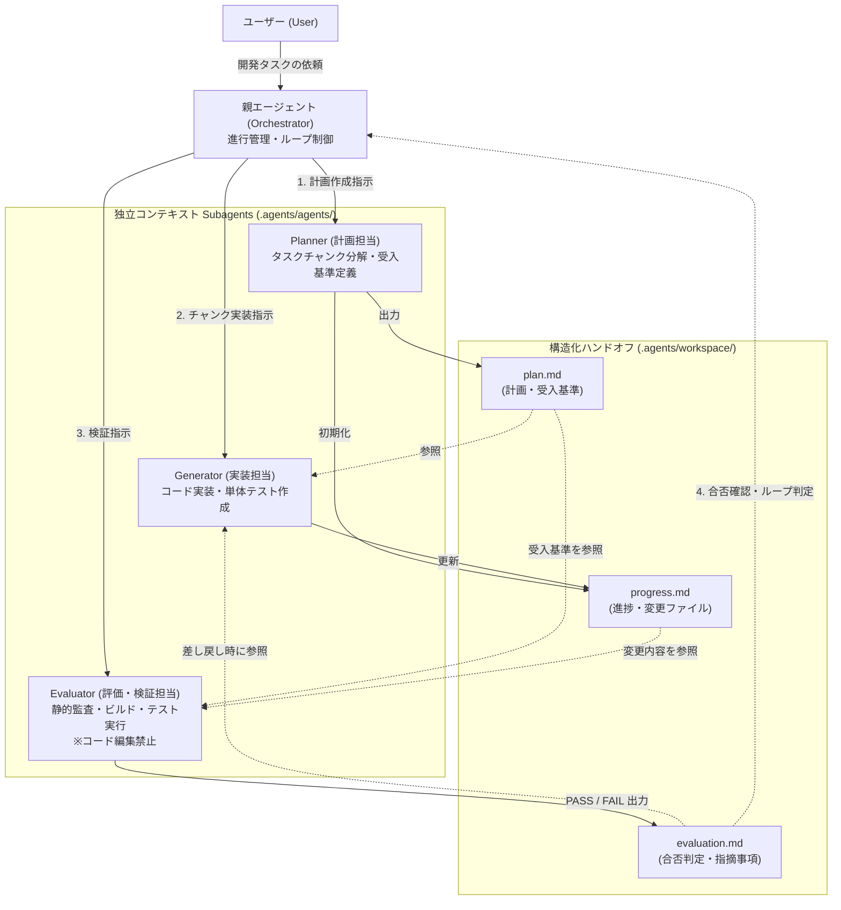
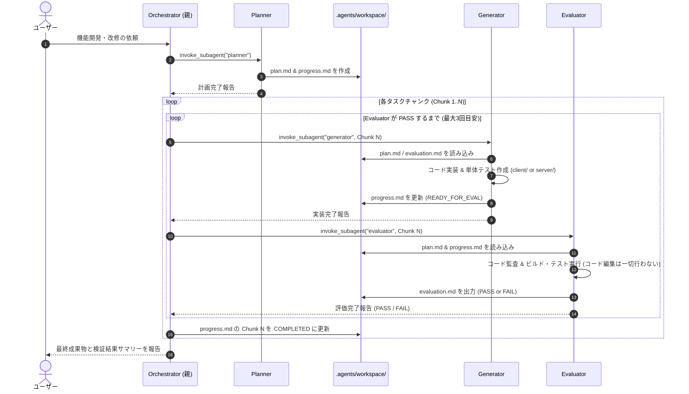

# 3エージェント自律開発ハーネス (Three-Agent Harness)

上位リンク: [[MOC|vcxBridge 設計・開発ドキュメント (MOC)]]

## 1. 背景と目的

単一の AI エージェントセッションで大規模・長時間のソフトウェア開発（計画・実装・テスト検証）を行うと、以下の課題が発生しやすくなります。

1. **コンテキスト不安（Context Anxiety）と肥大化**:
   - 試行錯誤のログでコンテキストウィンドウが圧迫されると、エージェントが「早くタスクを終わらせよう」としてスタブや未完成の状態で完了報告を行う傾向がある。
2. **自己評価バイアス（Self-Evaluation Bias）**:
   - コードを書いたエージェント自身がテスト・レビューを行うと、自らの設計ミスやエッジケースの漏れに対して甘い判定を下しやすい。
3. **役割の混同**:
   - 全体設計、細部のコーディング、品質監査を同一コンテキストで行き来することで、本来のアーキテクチャ制約を見失う。

これらを解決するため、Anthropic が提唱する **3エージェント構成（Planner / Generator / Evaluator）** を Antigravity CLI の Subagent 機能および構造化ハンドオフ（Structured Handoff）を用いて実装します。

---

## 2. アーキテクチャ全体像

親エージェントが **Orchestrator（進行管理役）** となり、独立したコンテキストウィンドウを持つ 3 つの Subagent（`planner`, `generator`, `evaluator`）を `invoke_subagent` で呼び出します。

---

## 3. ワークフロー（シーケンス）

---

## 4. ディレクトリ・ファイル構成

| パス                                            | 種別           | 説明                                                          |
| :-------------------------------------------- | :----------- | :---------------------------------------------------------- |
| `.agents/agents/planner/agent.md`             | Custom Agent | **Planner** のシステムプロンプト・メタデータ定義                              |
| `.agents/agents/generator/agent.md`           | Custom Agent | **Generator** のシステムプロンプト・メタデータ定義                            |
| `.agents/agents/evaluator/agent.md`           | Custom Agent | **Evaluator** のシステムプロンプト・メタデータ定義（コード編集禁止ガードレール付）            |
| `.agents/skills/three-agent-harness/SKILL.md` | Skill        | Orchestrator が 3 エージェントを連携させるための実行手順書                       |
| `.agents/workspace/README.md`                 | Docs         | 構造化ハンドオフ用ファイル（`plan.md`, `progress.md`, `evaluation.md`）の仕様 |
